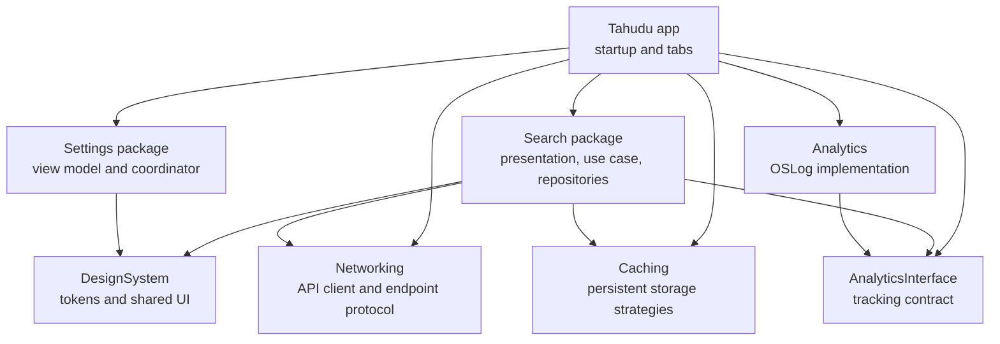
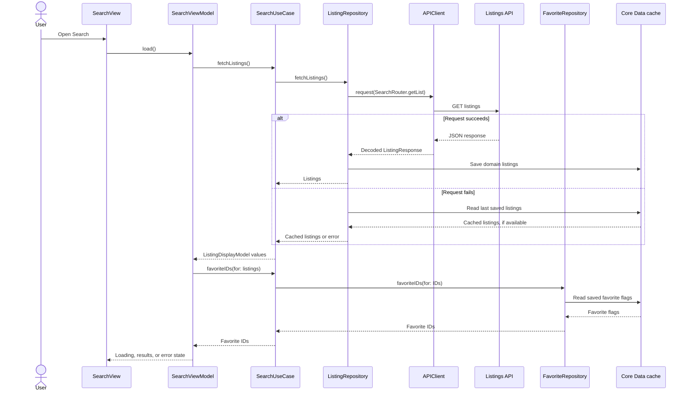
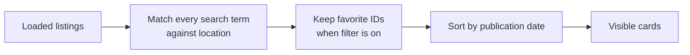

# Tahudu

**A modular iOS app for discovering property listings.** Tahudu brings browsing, local search, sorting, and saved properties into one Search experience. A separate My Account module demonstrates how UIKit screens can live alongside SwiftUI features without placing feature code in the app target.

<p align="center">
  
  
  
</p>

| Platform | UI | Architecture | Persistence | Tests |
| --- | --- | --- | --- | --- |
| iOS 15+ | SwiftUI and UIKit | MVVM with clean archeticture and protocol-based dependencies | Core Data, Keychain, UserDefaults | Swift Testing and snapshot tests |

> The original [Search screen reference](Screenshots/SearchScreen.png) is included in the repository. The implementation uses it as a visual starting point and adds live data, search, favorites, loading states, and accessibility.

## Contents

- [What the app does](#what-the-app-does)
- [Getting started](#getting-started)
- [Architecture](#architecture)
- [Search data flow](#search-data-flow)
- [Local persistence](#local-persistence)
- [Design system and accessibility](#design-system-and-accessibility)
- [Analytics and debugging](#analytics-and-debugging)
- [Testing](#testing)
- [Developer workflow](#developer-workflow)
- [Extending the app](#extending-the-app)

## What the app does

| Area | Current behavior |
| --- | --- |
| Search | Fetches listings from the hosted JSON endpoint and presents images, property details, tags, dates, and available contact actions. |
| Local search | Filters the loaded listings by city, area, or building text. Terms are matched against the location without case or accent sensitivity; typing does not make another network request. |
| Sort | Orders visible listings by publication date, latest or earliest first. |
| Favorites | Saves a listing locally, updates the heart state, and supports a visible “Favorites only” filter. Favorites remain available after relaunch. |
| Offline fallback | Saves successful listing responses locally and uses the last cached list when a later request fails. |
| My Account | Shows language, country, notifications, about, and feedback rows. Language opens iOS Settings; the other destinations currently log their selected action. |
| Contact actions | Shows buttons according to each listing's supported contact options. Taps currently log and track the action. |

The listing API is `https://simplejsoncms.com/api/m6nfoc4jlw`. It does not require an API key in this project.

## Getting started

### Requirements

- macOS with Xcode and an iOS Simulator.
- Git LFS for the reference images used by snapshot tests.
- Network access on first build to resolve the remote Swift packages and to fetch listings at runtime.

The app deployment target is **iOS 15**. Package manifests use Swift tools 6.0 with Swift 5 language mode.

### Set up and run

From the repository root:

```sh
git lfs install
git lfs pull
git config core.hooksPath .githooks
open Tahudu.xcodeproj
```

Select the **Tahudu** scheme and an iOS Simulator in Xcode, then run the app. The first launch loads Search. My Account is the second tab.

For a command-line build:

```sh
xcodebuild build \
  -project Tahudu.xcodeproj \
  -scheme Tahudu \
  -destination 'platform=iOS Simulator,name=iPhone 17 Pro,OS=26.5'
```

No local API credentials or generated configuration file are needed for the listing endpoint.

## Architecture

The app target owns startup, tab navigation, and dependency assembly. Feature implementation lives in local Swift packages. [`AppCompositionRoot`](Tahudu/AppCompositionRoot.swift) creates shared dependencies and passes them into the Search and Settings module factories.



| Package | Responsibility |
| --- | --- |
| [`Search`](Packages/Modules/Search/Search) | Search UI, state, local query and favorites behavior, display mapping, endpoint, and repositories. |
| [`Settings`](Packages/Modules/Settings/Settings) | My Account table, row models, view model, and navigation coordinator. |
| [`DesignSystem`](Packages/DesignSystem) | Colors, spacing, sizing, shared controls, search header, skeleton loading card, and UI extensions. |
| [`Networking`](Packages/Networking) | `APIEndpointProtocol`, request creation, `URLSession` transport, response validation, and JSON decoding. |
| [`Caching`](Packages/Caching) | A `CacheManagerProtocol` and strategies backed by Core Data, Keychain, or UserDefaults. |
| [`AnalyticsInterface`](Packages/AnalyticsInterface) | Event and tracking protocol shared by features. |
| [`Analytics`](Packages/Analytics) | An injectable tracker that currently records events with `OSLog`. |

## Search data flow

### Loading and offline fallback

Search starts loading in a SwiftUI `.task`. The repository asks the networking package to decode the endpoint response. A successful response is mapped to domain listings and written to Core Data. If a later request fails, the repository tries the stored list. Cancellation is propagated rather than treated as an offline failure.



If neither the request nor cache produces listings, Search shows a retry state. While loading, it shows skeleton cards. Search and favorites each have an empty state.

### Search, sort, and favorites

After the initial load, the view model retains the complete list. Every query, filter, or sort change recomputes the visible list in this order:



Tapping a heart calls `SearchViewModel.toggleFavorite`, which asks the use case to update `FavoriteRepository`. The repository writes or removes a per-listing value through the Core Data cache. After a successful write, the view model updates its favorite ID set and recomputes the visible list. If a write fails, it keeps the previous state and shows an error. Unfavoriting a card while “Favorites only” is active removes that card from the visible results.

## Local persistence

[`CacheManager`](Packages/Caching/Sources/Caching/Core/CacheManager.swift) is an actor that selects a storage implementation using `CacheStrategy`. Its protocol accepts `Data` and supplies `Codable` convenience methods. The Search module currently receives the default `.data()` strategy for both cached listings and favorite flags.

| Strategy | Backing store | Intended data |
| --- | --- | --- |
| `.data()` | Core Data SQLite | Cached models and favorite flags used by Search. |
| `.keychain(service:)` | iOS Keychain | Secrets stored at runtime. |
| `.userDefaults(suiteName:namespace:)` | UserDefaults | Small preferences and flags. |

The Core Data cache stores a key and encoded payload, so callers can persist `Codable` models without creating an entity for each model type. The Keychain and UserDefaults strategies are available to future features; they are not used for the current listing request. See the [Caching package guide](Packages/Caching/README.md) for examples and storage details.

Keep production credentials out of committed source. The Keychain protects values **after they are available to the app**; it does not make a secret embedded in an app binary private.

## Design system and accessibility

The DesignSystem package owns the app's reusable colors, spacing, radii, sizes, and controls. Search uses its header, contact button, clearable text field, and skeleton loading components. Settings uses its UIKit colors and table-cell configuration helper. Package resources contain shared colors and symbols; the app target retains app-specific assets such as listing images and the app icon.

Search controls expose accessibility labels and values, including the selected filter and sort order. Listing details are grouped for reading, loading has a spoken label, text follows Dynamic Type where supported, and list animations respect Reduce Motion. Keyboard dismissal is available from the search field, tapping outside it, and changing tabs.

## Analytics and debugging

Features depend on `AnalyticsEventTracking`, allowing a mock tracker in tests. The current `AnalyticsEventTracker` writes events to `OSLog`; it does not send them to a remote analytics service. Search also prints request and interaction messages during development.

In **Debug** builds, the app starts [netfox](https://github.com/kasketis/netfox) for inspecting network traffic. The netfox import and startup are excluded from Release builds.

## Testing

The `Tahudu` scheme includes [`Tahudu.xctestplan`](Tahudu.xctestplan), which enables code coverage and includes the app and package test targets. Business-layer tests use Swift Testing for networking, caching, analytics, repositories, use case behavior, and view model state. DesignSystem, Search, and Settings also have snapshot tests.

Run the test plan in Xcode with **Product → Test**, or from the repository root:

```sh
xcodebuild test \
  -project Tahudu.xcodeproj \
  -scheme Tahudu \
  -testPlan Tahudu \
  -destination 'platform=iOS Simulator,name=iPhone 17 Pro,OS=26.5'
```

Snapshot reference images are tracked with Git LFS. Use the **iPhone 17 Pro simulator on iOS 26.5** when comparing those references. See the [snapshot testing guide](.github/SNAPSHOT_TESTING.md) for recording and updating images. Other simulator versions may produce visual differences.

## Developer workflow

The repository uses a shared [Git hook directory](.githooks). Set it once per clone:

```sh
git config core.hooksPath .githooks
```

Before each commit, the hook scans staged changes with Gitleaks and then runs SwiftFormat. Both tools are downloaded into the ignored `.build/tools` directory when needed and checked against pinned SHA-256 hashes. A detected secret blocks the commit. SwiftFormat also runs as an Xcode Build Phase. The project rules live in [`.swiftformat`](.swiftformat) and [`.gitleaks.toml`](.gitleaks.toml).

Useful manual checks:

```sh
.githooks/swiftformat.sh lint
.githooks/gitleaks.sh
```

Snapshot PNGs use Git LFS through [`.gitattributes`](.gitattributes). Follow the [commit guide](.github/COMMIT_GUIDE.md) for commit titles and the [pull request template](.github/pull_request_template.md) when proposing changes.

## Extending the app

- **Add a feature module:** Create a local Swift package under `Packages/Modules`, keep feature-specific presentation, domain, and data code inside it, and expose a small factory for the app composition root.
- **Add a tab:** Add the tab case and presentation metadata in [`TahuduTabView`](Tahudu/TahuduTabView.swift), then assemble the new module in `AppCompositionRoot`. The tab view's content builder does not gain a new generic parameter for each tab.
- **Add an endpoint:** Add an `APIEndpointProtocol` conforming route in the owning feature and use `APIClientProtocol` in its repository. Keep HTTP transport and response decoding in Networking.
- **Add storage:** Choose a `CacheStrategy` and inject `CacheManagerProtocol` at the repository boundary. Keep storage-specific behavior in Caching.
- **Add a shared UI element:** Put reusable components or tokens in DesignSystem; keep feature-specific composition in the feature package.
- **Add tests:** Cover behavior at protocol boundaries with Swift Testing. Add snapshots when a shared component or screen has a visual contract worth preserving.

The current Settings destinations beyond Language and the listing contact actions are deliberate integration points for future work. Their current behavior is described above so new features can be added without assuming those flows already exist.
